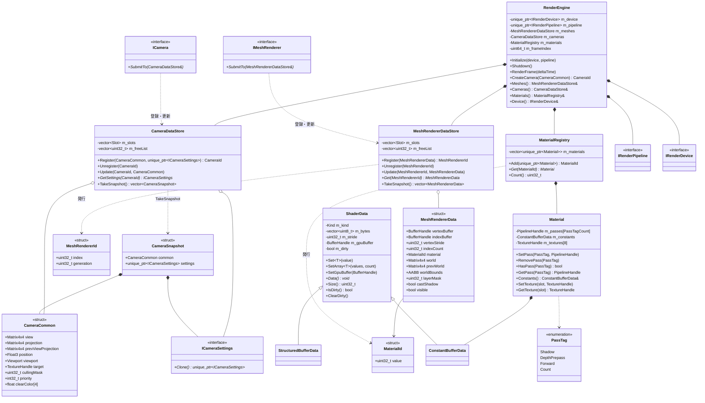
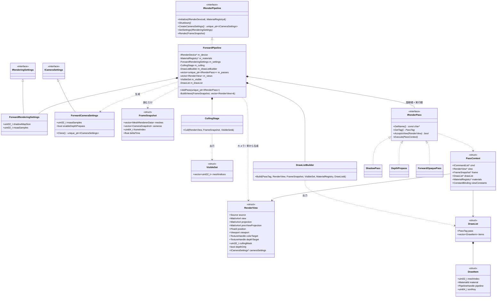
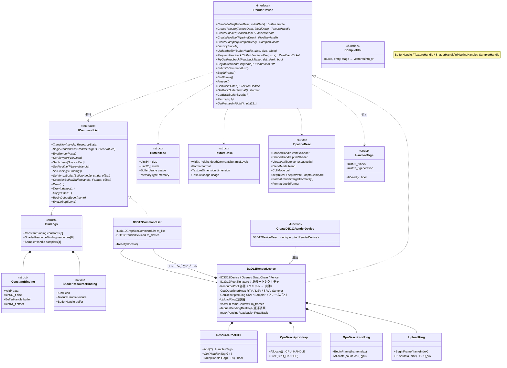

# NewRenderingSystem クラス設計図

DESIGN.md の構成を、現在のコードに合わせてクラス図にしたもの。名前空間はすべて `NRS`。
図は3枚に分けている（全体 / パイプライン / RHI）。矢印は依存の向き（上位 → 下位）。

---

## 1. 全体（RenderEngine とデータ）

ポイント
- 具象型を知っているのは `RenderEngine` だけ。
- `IMeshRenderer` / `ICamera` はストアに書き込むだけで、パイプラインのことは知らない。
- `Material` とデータストアはハンドル（`PipelineHandle` / `TextureHandle` / `BufferHandle`）を持つだけで、`IRenderDevice` は知らない。

---

## 2. パイプライン

1ビューごとの流れ: `BuildViews` → `CullingStage::Cull` → パスごとに `AcceptsView` → `DrawListBuilder::Build`（Material に PSO が無ければ除外） → `IRenderPass::Execute`

---

## 3. RHI（IRenderDevice / ICommandList / D3D12 実装）

ポイント
- `ID3D12*` / `D3D12_*` / `DXGI_*` が出てくるのは `RHI/D3D12` の中だけ（`D3D12RenderDevice` と `D3D12CommandList` は .cpp 内の無名名前空間に隠している）。
- 共通ルートシグネチャ: `b0` View / `b1` Material / `b2` Object（ルート CBV）、`t0..t7`（SRV テーブル）、`s0..s3`（サンプラーテーブル）。
- 動作確認用に `Samples/TriangleSample` があり、`IRenderDevice` / `ICommandList` だけを使って三角形を描く。
